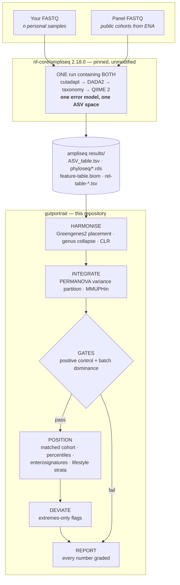

# gutportrait

[](https://www.nextflow.io/)
[](https://github.com/nf-core/tools/releases/tag/4.1.0)
[](https://docs.conda.io/en/latest/)
[](https://www.docker.com/)
[](https://sylabs.io/docs/)

**Cross-cohort comparison of personal 16S gut microbiome profiles.**

`gutportrait` answers one question honestly: _where does this gut microbiome sit relative
to other people's, and how far can that comparison be trusted?_

It is a downstream companion to [`nf-core/ampliseq`](https://nf-co.re/ampliseq), not a
replacement for it. **ampliseq turns reads into ASVs. gutportrait turns ASVs into a
defensible comparison.** The two run side by side, and this README explains exactly how.

> **Status: early development — third slice working.** The upstream half is validated
> end-to-end on real data (see [Validation](#validation)). Of gutportrait itself, genus
> collapse, per-genus CLR percentiles, alpha diversity, batch diagnosis and correction, both
> gates, a stability check and the deviation flags are implemented and pass the test
> profile. Cohort matching and the report are not built yet (see
> [Implementation status](#implementation-status)). Nothing here is medical advice and
> nothing it produces is diagnostic.

---

## Why two pipelines instead of one

The hard part of comparing your microbiome to someone else's is not computing diversity.
It is that **between-study technical variance in 16S routinely rivals the biological
signal.** NIST sent one identical faecal reference material to seven consumer providers
and got between-provider spread on the same scale as spread between different donors. A
2024 European evaluation of microbiome testing services reached a similar conclusion about
reproducibility.

Three separable layers cause it:

| Layer              | What differs between two datasets                                                       | Can it be fixed?                                                                           |
| ------------------ | --------------------------------------------------------------------------------------- | ------------------------------------------------------------------------------------------ |
| **Wet lab**        | Primers, extraction kit, lysis, PCR cycles, instrument, read length                     | **No — not downstream.** Only avoidable by matching protocol, or carried as a batch term   |
| **Bioinformatics** | Denoiser, truncation, chimera method, reference database and version, rarefaction depth | **Yes — by co-processing.** Run everything through one pipeline invocation                 |
| **Statistical**    | Compositionality, sequencing depth, zero-inflation, cohort composition                  | Yes — CLR-space methods, fixed rarefaction, matched-cohort selection, explicit batch terms |

The design principle that follows:

> **Co-processing beats batch correction.** A batch effect you never introduced needs no
> model. Correction is the fallback for what you cannot co-process, not the strategy.

That is why the reference panel is built from **raw public FASTQ** and run through the
_same ampliseq invocation_ as your own reads — rather than assembled from published
abundance tables and corrected afterwards. It is more work, and it is the entire point.

**And it is why ampliseq is used unmodified and version-pinned rather than forked.**
Pinning `-r 2.18.0` is precisely what makes a sample processed today comparable to one
processed next year. A fork would trade that guarantee for maintenance burden. If
something genuinely belongs upstream, the right move is a PR to nf-core.

---

## How they work side by side



**The handoff is a directory, not a file format we invented.** gutportrait consumes
ampliseq's published outputs and never touches a FASTQ:

| ampliseq produces                                  | gutportrait uses it for                            |          |
| -------------------------------------------------- | -------------------------------------------------- | -------- |
| `dada2/ASV_table.tsv`                              | the count matrix: every sample, personal and panel | **used** |
| `dada2/ASV_tax_species.<db>.tsv`                   | named-rank taxonomy for the genus collapse         | **used** |
| `dada2/ASV_seqs.fasta`                             | phylogenetic placement (V4-projected arm)          | planned  |
| `qiime2/phylogenetic_tree/tree.nwk`                | phylogenetic diversity                             | planned  |
| `phyloseq/*.rds`, `treesummarizedexperiment/*.rds` | direct input to the R modules                      | planned  |

`qiime2/rel_abundance_tables/rel-table-*.tsv` is deliberately **not** used — see the
rank-numbering caveat below.

Because the boundary is ampliseq's own published output, **you can run gutportrait on any
ampliseq results directory** — not just ones produced by this project.

> ### ⚠ Rank numbering depends on the taxonomy database
>
> `rel-table-N.tsv` is numbered by _column position_ in the taxonomy string, not by rank
> name. **SBDI-GTDB emits both a `Domain` and a `Kingdom` column** (both `Bacteria`), which
> shifts every rank down by one relative to SILVA. ampliseq only writes tables 2–6, so with
> SBDI-GTDB:
>
> | table         | SILVA         | SBDI-GTDB       |
> | ------------- | ------------- | --------------- |
> | `rel-table-6` | Genus         | **Family**      |
> | genus         | `rel-table-6` | **not emitted** |
>
> gutportrait therefore does **not** read a pre-made genus table. It collapses to genus
> itself from `dada2/ASV_tax_species.<db>.tsv`, whose columns are named ranks, joined to
> the ASV table. Verified empirically on ampliseq 2.18.0 with
> `--dada_ref_taxonomy sbdi-gtdb`.

---

## Quick start

### Step 1 — profile with ampliseq

Your samples and the reference panel go in **one** samplesheet, so DADA2 learns a single
error model across everything. The `run` column declares sequencing runs, so per-run error
models are estimated and merged (this is the samplesheet equivalent of
`--multiple_sequencing_runs`, which applies only to `--input_folder` input):

```tsv
sample	fastq_1	fastq_2	run
self_sample1	/data/s1_R1.fastq.gz	/data/s1_R2.fastq.gz	RUN_A
panel_ERR123	/data/ERR123_1.fastq.gz	/data/ERR123_2.fastq.gz	RUN_B
```

> Sample IDs must match `^[a-zA-Z][a-zA-Z0-9_]+$` — they must start with a letter.

```bash
nextflow run nf-core/ampliseq -r 2.18.0 -profile singularity \
    --input samplesheet.tsv \
    --metadata metadata.tsv \
    --FW_primer CCTACGGGNGGCWGCAG \
    --RV_primer GACTACHVGGGTATCTAATCC \
    --trunclenf 280 --trunclenr 240 \
    --dada_ref_taxonomy silva \
    --outdir ampliseq_results
```

**Pin every one of those values and never change them mid-project.** Primers, truncation
lengths, database and pipeline version are all part of the assay; changing one makes your
timepoints incomparable to each other.

> **Why SILVA and not ampliseq's default.** ampliseq 2.18.0 defaults to SBDI-GTDB. On
> these V3–V4 reads that left **38.6% of ASVs classified no deeper than "Bacteria"**;
> SILVA 138.2 on the identical ASVs left 0.3%. Genus-or-better coverage was **48.6% vs
> 79.0%**, and the worst per-sample unassigned read fraction fell from 49.7% to 9.9%.
> GTDB does reach species more often where it classifies at all (27.0% vs 21.6%), but
> genus percentiles are what this pipeline reports, so coverage wins. Measure this on
> your own data before trusting any default.

### Step 2 — compare with gutportrait

gutportrait takes its own samplesheet. It has one row per sample of the ampliseq run and
says which samples are yours, which are the reference panel, and what is known about each:

```csv
sample,role,study,run,age_cat,sex,bmi_cat,country
self_sample1,personal,self,RUN_A,40s,female,Normal,Netherlands
panel_ERR123,panel,PRJEB00000,RUN_B,,,,
```

| column                                 | required | meaning                                                                                                                  |
| -------------------------------------- | -------- | ------------------------------------------------------------------------------------------------------------------------ |
| `sample`                               | yes      | must match a column of ampliseq's `ASV_table.tsv` exactly                                                                |
| `role`                                 | yes      | `personal` or `panel`                                                                                                    |
| `study`                                | yes      | the batch unit. Your samples get a study of their own — mixing roles within one study is an error                        |
| `run`                                  | yes      | sequencing run, the same value as in the ampliseq samplesheet                                                            |
| `age_cat`, `sex`, `bmi_cat`, `country` | no       | used for cohort matching and the real-effect positive control. Leave empty where unknown, which is normal for ENA panels |

```bash
nextflow run Biocentric/gutportrait -profile singularity \
    --input gutportrait_samplesheet.csv \
    --ampliseq_results ampliseq_results/ \
    --taxonomy_db silva \
    --arm native \
    --outdir gutportrait_results
```

No data yet? `-profile test,singularity` runs the whole pipeline on a synthetic dataset
with known signals planted in it; see [docs/usage.md](docs/usage.md#test-profile).

---

## What gutportrait does

| Stage         | What it does                                                                                                                                                                                                                                                                                                           |
| ------------- | ---------------------------------------------------------------------------------------------------------------------------------------------------------------------------------------------------------------------------------------------------------------------------------------------------------------------- |
| **Harmonise** | Greengenes2 placement for phylogenetic diversity; genus collapse and centred-log-ratio for everything else. Percentiles are computed in **CLR space**, because a raw relative abundance is a ratio to an unmeasured total — treating it as a measurement is what manufactures "your _Akkermansia_ is low" out of noise |
| **Integrate** | PERMANOVA variance partition across study, run, age, sex, BMI. MMUPHin batch correction, with every downstream number computed on **both corrected and uncorrected** data — anything that flips between them is reported as unstable, not as a finding                                                                 |
| **Position**  | Matched-cohort selection, alpha/beta percentiles, enterosignature mixture by NNLS, per-genus CLR percentiles, and lifestyle strata contrasts computed _within_ the panel                                                                                                                                               |
| **Deviate**   | Extremes-only flags — very low diversity, single-taxon dominance, Proteobacteria bloom — measured against the panel's **between-study spread**, and raised only when both arms agree                                                                                                                                   |
| **Report**    | Every number carries five things: value, technical uncertainty, reference _n_, evidence grade, and what it does not mean                                                                                                                                                                                               |

### Gates that can veto or demote the report

Gates that fail loudly are what separate this from a dashboard. Every threshold below is a
parameter with a strict default, and the report states the values it used.

- **Positive control, injected.** A known effect is planted in a copy of the panel: one
  high-prevalence genus is doubled in a random half of the samples, stratified by study,
  and the integration is run again. If the planted effect does not come back (right sign,
  p < 0.01, at least half its size), the run **stops with a diagnostic instead of
  producing a report**. A correction that erases a signal we put there ourselves would
  erase real ones too. This form needs no metadata, which most public panels lack.
- **Positive control, real.** Where panel samples carry age bands, Shannon diversity
  should rise with adult age. If correction destroys a relationship that was significant
  before it, the run stops.
- **Batch dominance.** A lifestyle contrast counts as a finding only if it explains more
  variance than study does (PERMANOVA on Aitchison distance). A personal deviation counts
  only if it is larger than the largest between-study difference in the panel. Anything
  else is demoted to _"orientation only"_, and if study explains more than 10% of the
  variance overall, the report says so at the top, in those words.

---

## Implementation status

| Stage        | Module                                                                                                              | Status                                                                                                               |
| ------------ | ------------------------------------------------------------------------------------------------------------------- | -------------------------------------------------------------------------------------------------------------------- |
| Harmonise    | `COLLAPSE_GENUS`: genus collapse from named-rank taxonomy; unassigned reads stay in as an explicit `Unassigned` row | ✅ implemented                                                                                                       |
| Harmonise    | phylogenetic placement for the V4-projected arm                                                                     | planned. First test whether ampliseq's own `--run_pplace` accepts a Greengenes2 backbone; if so, no module is needed |
| Integrate    | `BATCH_DIAGNOSE`: PERMANOVA (vegan `adonis2`) on Aitchison distance, R²(study) and study + variable models          | ✅ implemented (diagnosis only)                                                                                      |
| Integrate    | `BATCH_CORRECT`: MMUPHin harmonises the panel studies; personal samples are never corrected                         | ✅ implemented                                                                                                       |
| Gates        | `POSITIVE_CONTROL`: injected signal must survive correction, or the run stops                                       | ✅ implemented                                                                                                       |
| Gates        | `BATCH_DOMINANCE`: study banner, contrast-by-contrast verdicts, personal positioning against between-study spread   | ✅ implemented                                                                                                       |
| Position     | `PERCENTILE_STABILITY`: every genus position against the uncorrected and the corrected panel                        | ✅ implemented                                                                                                       |
| Position     | `TAXON_PERCENTILES`: per-genus CLR percentile of each personal sample against the panel                             | ✅ implemented, against the **whole, uncorrected** panel for now. Matching and correction arrive with Integrate      |
| Position     | `ALPHA_DIVERSITY`: rarefied Shannon, richness and evenness, with pooled and per-study position                      | ✅ implemented                                                                                                       |
| Position     | cohort matching, beta position, enterosignatures, lifestyle contrasts                                               | planned                                                                                                              |
| Deviate      | `DEVIATION_FLAGS`: the seven extremes-only checks of DECISIONS.md D12, against the between-study spread             | ✅ implemented, single-arm: the cross-arm agreement rule needs both arms                                             |
| Longitudinal | within-person noise floor, behind `--longitudinal`                                                                  | planned                                                                                                              |
| Report       | English, HTML and PDF                                                                                               | planned                                                                                                              |

Until the gates exist, a percentile from this pipeline is a position, not a finding.

---

## Validation

The upstream half is confirmed working on real data — three personal V3–V4 samples
(341F/785R, MiSeq 2×300), each from a different sequencing run:

| sample | raw pairs | primer-trimmed | merged | non-chimeric | end-to-end |
| ------ | --------- | -------------- | ------ | ------------ | ---------- |
| A      | 59,128    | 98.9%          | 87.3%  | 23,859       | 40.4%      |
| B      | 46,817    | 98.9%          | 88.7%  | 20,478       | 43.7%      |
| C      | 15,661    | 99.5%          | 83.6%  | 7,744        | 49.4%      |

Primer retention near 99% confirms the primer pair; merge rates of 84–89% confirm the
truncation lengths leave adequate overlap on a ~465 bp amplicon read at 2×301.

---

## What this will and will not tell you

**Will:** where a sample sits relative to people processed identically to it — on
diversity, genus abundance ranks and enterosignature mixture, each with an honest
uncertainty; how lifestyle axes with real evidence behind them separate people _within the
reference cohort_; and whether anything in the sample is grossly abnormal relative to the
panel's own between-study spread.

**Will not:** diagnose anything; produce a wellness score or any composite index (validated
indices such as GMHI and GMWI2 require species-level **shotgun** profiles — no 16S path
exists); tell you what to eat; or certify that a microbiome is healthy. _"Nothing stands
out"_ is the strongest negative result available here, and it is not the same statement.

16S detects gross abnormality far better than it certifies normality. The report is written
to respect that asymmetry rather than paper over it.

---

## Development

Built from the nf-core template and kept lint-clean:

```bash
nextflow run . -profile test,singularity --outdir results_test   # synthetic end-to-end run
nextflow lint .
nf-core pipelines lint
```

The test fixture is generated, not collected: `tests/fixtures/make_synthetic_fixture.py`
writes it deterministically, with known signals planted for each stage to recover. No real
personal data belongs in this repository, in tests or anywhere else; see
[docs/CONTRIBUTING.md](docs/CONTRIBUTING.md#pipeline-specific-contribution-guidelines).

This pipeline follows nf-core conventions but is **not an official nf-core pipeline** — it
is hosted under [Biocentric](https://github.com/Biocentric) and is not listed on nf-co.re.
Compliance buys the real benefits: reproducible structure, pinned containers,
schema-validated parameters, and a lint suite that catches drift.

## Credits

`gutportrait` is developed by [Biocentric](https://www.biocentric.nl).

It stands almost entirely on [nf-core/ampliseq](https://nf-co.re/ampliseq), which does the
sequence processing. If you use this, cite ampliseq and the tools it wraps — see
[CITATIONS.md](CITATIONS.md).

## License

MIT — see [LICENSE](LICENSE).

---

_Not medical advice. Nothing produced by this pipeline is diagnostic._
