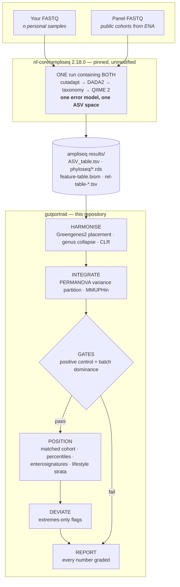

# gutportrait

**Cross-cohort comparison of personal 16S gut microbiome profiles.**

`gutportrait` answers one question honestly: *where does this gut microbiome sit relative
to other people's, and how far can that comparison be trusted?*

It is a downstream companion to [`nf-core/ampliseq`](https://nf-co.re/ampliseq), not a
replacement for it. **ampliseq turns reads into ASVs. gutportrait turns ASVs into a
defensible comparison.** The two run side by side, and this README explains exactly how.

> **Status: early development.** The upstream half is validated end-to-end (see
> [Validation](#validation)); the gutportrait modules are being built. Nothing here is
> medical advice and nothing it produces is diagnostic.

---

## Why two pipelines instead of one

The hard part of comparing your microbiome to someone else's is not computing diversity.
It is that **between-study technical variance in 16S routinely rivals the biological
signal.** NIST sent one identical faecal reference material to seven consumer providers
and got between-provider spread on the same scale as spread between different donors. A
2024 European evaluation of microbiome testing services reached a similar conclusion about
reproducibility.

Three separable layers cause it:

| Layer | What differs between two datasets | Can it be fixed? |
|---|---|---|
| **Wet lab** | Primers, extraction kit, lysis, PCR cycles, instrument, read length | **No — not downstream.** Only avoidable by matching protocol, or carried as a batch term |
| **Bioinformatics** | Denoiser, truncation, chimera method, reference database and version, rarefaction depth | **Yes — by co-processing.** Run everything through one pipeline invocation |
| **Statistical** | Compositionality, sequencing depth, zero-inflation, cohort composition | Yes — CLR-space methods, fixed rarefaction, matched-cohort selection, explicit batch terms |

The design principle that follows:

> **Co-processing beats batch correction.** A batch effect you never introduced needs no
> model. Correction is the fallback for what you cannot co-process, not the strategy.

That is why the reference panel is built from **raw public FASTQ** and run through the
*same ampliseq invocation* as your own reads — rather than assembled from published
abundance tables and corrected afterwards. It is more work, and it is the entire point.

**And it is why ampliseq is used unmodified and version-pinned rather than forked.**
Pinning `-r 2.18.0` is precisely what makes a sample processed today comparable to one
processed next year. A fork would trade that guarantee for maintenance burden. If
something genuinely belongs upstream, the right move is a PR to nf-core.

---

## How they work side by side



**The handoff is a directory, not a file format we invented.** gutportrait consumes
ampliseq's published outputs and never touches a FASTQ:

| ampliseq produces | gutportrait consumes it for |
|---|---|
| `dada2/ASV_table.tsv`, `ASV_seqs.fasta` | ASV-level input, phylogenetic placement |
| `dada2/ASV_tax.*.tsv` | taxonomy, genus collapse |
| `qiime2/abundance_tables/feature-table.biom` | count matrix |
| `qiime2/rel_abundance_tables/rel-table-*.tsv` | rank-level relative abundance — **see the rank-numbering caveat below** |
| `phyloseq/*.rds`, `treesummarizedexperiment/*.rds` | direct input to the R modules |
| `qiime2/phylogenetic_tree/tree.nwk` | phylogenetic diversity |

Because the boundary is ampliseq's own published output, **you can run gutportrait on any
ampliseq results directory** — not just ones produced by this project.

> ### ⚠ Rank numbering depends on the taxonomy database
>
> `rel-table-N.tsv` is numbered by *column position* in the taxonomy string, not by rank
> name. **SBDI-GTDB emits both a `Domain` and a `Kingdom` column** (both `Bacteria`), which
> shifts every rank down by one relative to SILVA. ampliseq only writes tables 2–6, so with
> SBDI-GTDB:
>
> | table | SILVA | SBDI-GTDB |
> |---|---|---|
> | `rel-table-6` | Genus | **Family** |
> | genus | `rel-table-6` | **not emitted** |
>
> gutportrait therefore does **not** read a pre-made genus table. It collapses to genus
> itself from `dada2/ASV_tax_species.*.tsv` (or the `phyloseq` object's `tax_table`, which
> carries named ranks and is immune to this) joined to the ASV table. Verified empirically
> on ampliseq 2.18.0 with `--dada_ref_taxonomy sbdi-gtdb`.

---

## Quick start

### Step 1 — profile with ampliseq

Your samples and the reference panel go in **one** samplesheet, so DADA2 learns a single
error model across everything. The `run` column declares sequencing runs, so per-run error
models are estimated and merged (this is the samplesheet equivalent of
`--multiple_sequencing_runs`, which applies only to `--input_folder` input):

```tsv
sample	fastq_1	fastq_2	run
mmz_sample1	/data/s1_R1.fastq.gz	/data/s1_R2.fastq.gz	RUN_A
panel_ERR123	/data/ERR123_1.fastq.gz	/data/ERR123_2.fastq.gz	RUN_B
```

> Sample IDs must match `^[a-zA-Z][a-zA-Z0-9_]+$` — they must start with a letter.

```bash
nextflow run nf-core/ampliseq -r 2.18.0 -profile singularity \
    --input samplesheet.tsv \
    --metadata metadata.tsv \
    --FW_primer CCTACGGGNGGCWGCAG \
    --RV_primer GACTACHVGGGTATCTAATCC \
    --trunclenf 280 --trunclenr 240 \
    --dada_ref_taxonomy sbdi-gtdb \
    --outdir ampliseq_results
```

**Pin every one of those values and never change them mid-project.** Primers, truncation
lengths, database and pipeline version are all part of the assay; changing one makes your
timepoints incomparable to each other.

### Step 2 — compare with gutportrait

```bash
nextflow run Biocentric/gutportrait -profile singularity \
    --input samplesheet.csv \
    --ampliseq_results ampliseq_results/ \
    --panel_manifest panel/manifest.tsv \
    --arm native \
    --outdir gutportrait_results
```

---

## What gutportrait does

| Stage | What it does |
|---|---|
| **Harmonise** | Greengenes2 placement for phylogenetic diversity; genus collapse and centred-log-ratio for everything else. Percentiles are computed in **CLR space**, because a raw relative abundance is a ratio to an unmeasured total — treating it as a measurement is what manufactures "your *Akkermansia* is low" out of noise |
| **Integrate** | PERMANOVA variance partition across study, run, age, sex, BMI. MMUPHin batch correction, with every downstream number computed on **both corrected and uncorrected** data — anything that flips between them is reported as unstable, not as a finding |
| **Position** | Matched-cohort selection, alpha/beta percentiles, enterosignature mixture by NNLS, per-genus CLR percentiles, and lifestyle strata contrasts computed *within* the panel |
| **Deviate** | Extremes-only flags — very low diversity, single-taxon dominance, Proteobacteria bloom — measured against the panel's **between-study spread**, and raised only when both arms agree |
| **Report** | Every number carries five things: value, technical uncertainty, reference *n*, evidence grade, and what it does not mean |

### Two gates that can veto the report

Gates that fail loudly are what separate this from a dashboard.

- **Positive control** — the integrated dataset must recover an effect known to be strong
  in the panel (age, sex, recent antibiotics). If merging and batch-correcting destroyed a
  signal that is definitely there, the integration is broken and the run **stops with a
  diagnostic instead of producing a report.**
- **Batch dominance** — if variance explained by study or sequencing run exceeds that of
  the biological variable being asked about, every population-facing claim is demoted to
  *"orientation only"* and the report says so at the top, in those words.

---

## Validation

The upstream half is confirmed working on real data — three personal V3–V4 samples
(341F/785R, MiSeq 2×300), each from a different sequencing run:

| sample | raw pairs | primer-trimmed | merged | non-chimeric | end-to-end |
|---|---|---|---|---|---|
| A | 59,128 | 98.9% | 87.3% | 23,859 | 40.4% |
| B | 46,817 | 98.9% | 88.7% | 20,478 | 43.7% |
| C | 15,661 | 99.5% | 83.6% | 7,744 | 49.4% |

Primer retention near 99% confirms the primer pair; merge rates of 84–89% confirm the
truncation lengths leave adequate overlap on a ~465 bp amplicon read at 2×301.

---

## What this will and will not tell you

**Will:** where a sample sits relative to people processed identically to it — on
diversity, genus abundance ranks and enterosignature mixture, each with an honest
uncertainty; how lifestyle axes with real evidence behind them separate people *within the
reference cohort*; and whether anything in the sample is grossly abnormal relative to the
panel's own between-study spread.

**Will not:** diagnose anything; produce a wellness score or any composite index (validated
indices such as GMHI and GMWI2 require species-level **shotgun** profiles — no 16S path
exists); tell you what to eat; or certify that a microbiome is healthy. *"Nothing stands
out"* is the strongest negative result available here, and it is not the same statement.

16S detects gross abnormality far better than it certifies normality. The report is written
to respect that asymmetry rather than paper over it.

---

## Development

Built from the nf-core template and kept lint-clean:

```bash
nf-core pipelines lint
```

This pipeline follows nf-core conventions but is **not an official nf-core pipeline** — it
is hosted under [Biocentric](https://github.com/Biocentric) and is not listed on nf-co.re.
Compliance buys the real benefits: reproducible structure, pinned containers,
schema-validated parameters, and a lint suite that catches drift.

## Credits

`gutportrait` is developed by [Biocentric](https://www.biocentric.nl).

It stands almost entirely on [nf-core/ampliseq](https://nf-co.re/ampliseq), which does the
sequence processing. If you use this, cite ampliseq and the tools it wraps — see
[CITATIONS.md](CITATIONS.md).

## License

MIT — see [LICENSE](LICENSE).

---

*Not medical advice. Nothing produced by this pipeline is diagnostic.*
